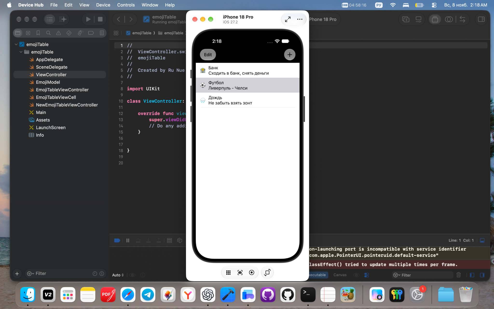
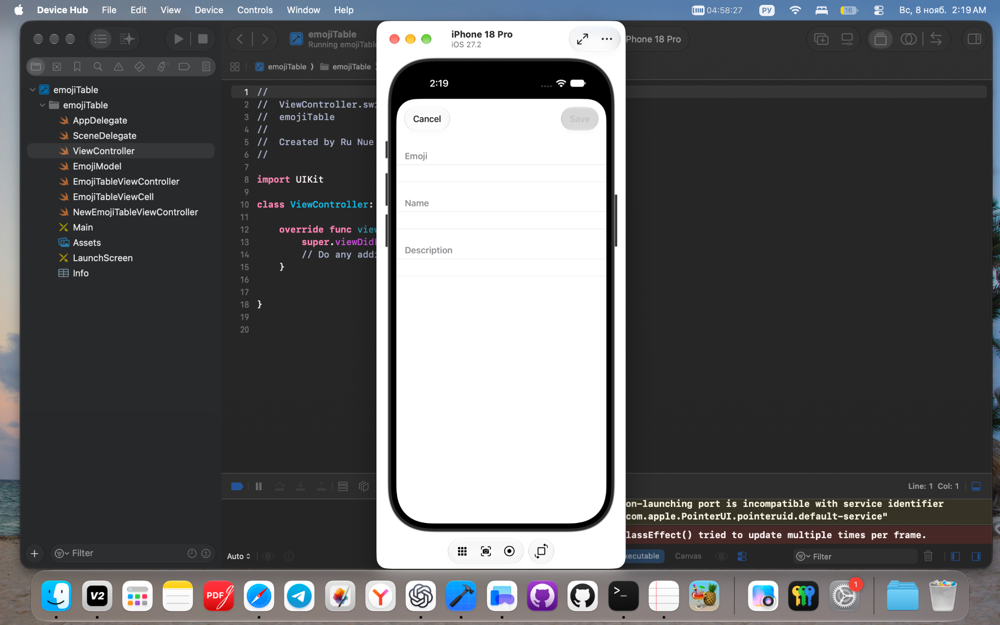
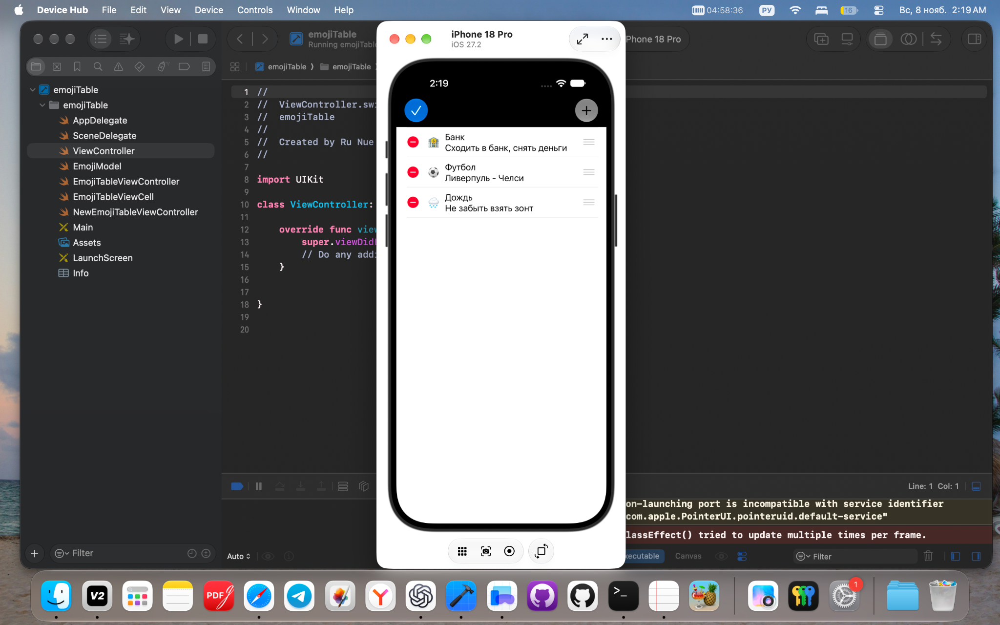

# 📝 emojiTable — напоминания с эмодзи

Небольшое учебное iOS-приложение на **Swift и UIKit**. Сходить в банк, не пропустить футбол, захватить зонт — у каждого дела здесь есть свой эмодзи, название и короткое описание.

Проект — часть моего пути в iOS-разработке: на нём я практикую работу с `UITableView`, собственными ячейками, формами и передачей данных между экранами.

## Что уже умеет приложение

- Показывает список напоминаний с эмодзи, названием и описанием.
- Позволяет добавить запись через кнопку **+** и изменить существующую нажатием на строку.
- Включает **Save**, когда все три поля непустые; **Cancel** закрывает форму без сохранения.
- Удаляет записи и позволяет менять их порядок в режиме **Edit**.
- Предлагает действия свайпом вправо: **Done** удаляет запись из списка, **Favourite** переключает признак избранного.

> Это учебная версия. Записи хранятся только в памяти: после перезапуска приложение снова показывает три исходных примера. Уведомлений по времени, дат, синхронизации и истории выполненных дел пока нет. Избранное не вынесено в отдельный список и не отмечается в самой ячейке.

## Как выглядит

Скриншоты запуска в симуляторе: основной список, создание записи и режим редактирования. Нажмите на изображение, чтобы рассмотреть его крупнее.

| Список напоминаний | Новая запись | Редактирование списка |
| :---: | :---: | :---: |
| [](reminders-list.png) | [](reminders-form.png) | [](reminders-edit.png) |

## Что я здесь изучаю

**Swift · UIKit · Storyboard · Auto Layout · SF Symbols**

- `UITableViewController`: источник данных, переиспользование, добавление и удаление строк.
- Собственную `UITableViewCell` с тремя текстовыми элементами.
- Форму на статической таблице и проверку заполнения полей.
- `UINavigationController`, segue и unwind segue для переходов и возврата результата.
- `UIContextualAction` для действий свайпом.
- Согласованное изменение массива моделей и отображаемой таблицы.

Сторонних библиотек нет. Модель, ячейка и контроллеры экранов находятся в отдельных файлах.

## Как запустить

1. Скачайте репозиторий через **Code → Download ZIP** и распакуйте архив либо клонируйте:
   ```bash
   git clone https://github.com/nyuchosee/emojiTable.git
   ```
2. Откройте `emojiTable/emojiTable.xcodeproj` из корня репозитория.
3. Выберите схему **emojiTable** и симулятор iPhone.
4. Нажмите **⌘R**.

В исходных настройках проекта указаны **iOS 14.5** и режим языка **Swift 5**; проект создан в Xcode 12.5.1. Это параметры проекта, а не обещание совместимости со всеми версиями Xcode. Если установленный Xcode сообщает о неподдерживаемом Deployment Target, выберите поддерживаемую им минимальную версию iOS в настройках target.

## Где что лежит

```text
emojiTable/
├── emojiTable.xcodeproj
└── emojiTable/
    ├── EmojiModel.swift                   # Данные одной записи
    ├── EmojiTableViewController.swift     # Список и действия над записями
    ├── EmojiTableViewCell.swift           # Эмодзи, название и описание в ячейке
    ├── NewEmojiTableViewController.swift  # Создание и редактирование
    ├── Base.lproj/Main.storyboard         # Экраны, ограничения и переходы
    ├── Assets.xcassets
    ├── AppDelegate.swift
    └── SceneDelegate.swift
```

В исходниках сохранены учебные названия `Emoji` и `emojiTable`; заголовок главного экрана задан как `Emoji Reader`.

## Идеи для следующих шагов

- Сохранять записи между запусками.
- Показывать избранное прямо в ячейке.
- Отделить завершение дела от удаления.
- Улучшить проверку ввода: не принимать строки из одних пробелов.
- Добавить даты и локальные уведомления.

Это планы для дальнейшей практики, а не уже реализованные возможности.

